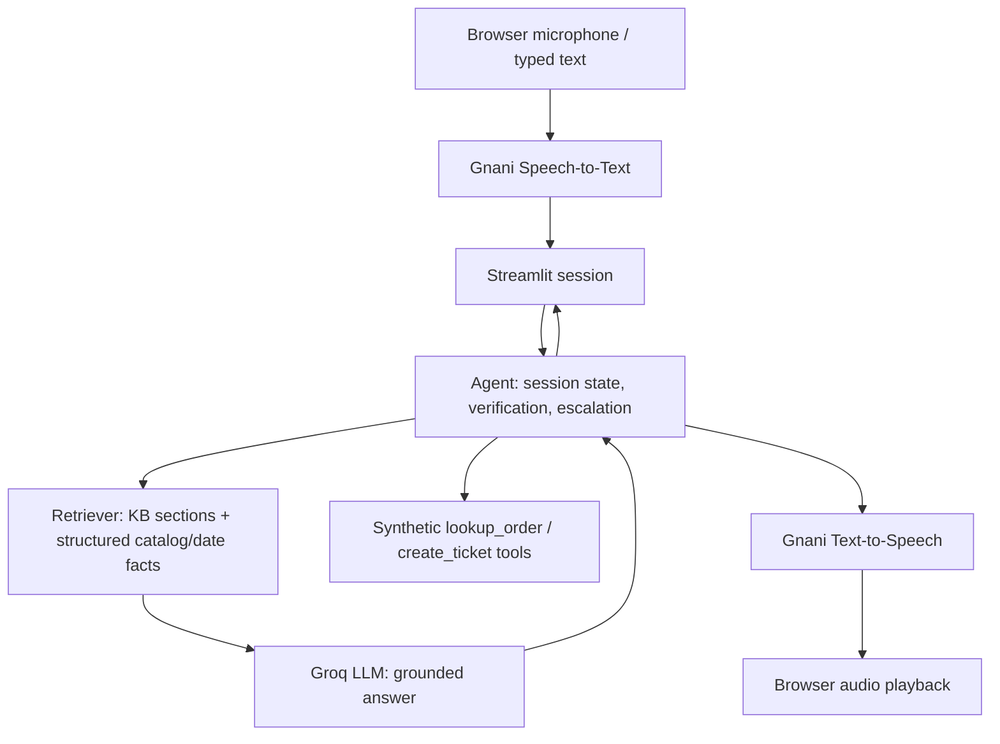

# Architecture and trust boundaries

**Baseline** uses a separate prompt-only LLM call, with neither retrieval nor tools. **RAG** indexes current policy markdown; it retrieves word/character TF-IDF sections and adds grounded product catalog and deterministic business-day facts. It is not a semantic embedding database. **Verification** occurs in Python against a synthetic tool; unverified account details are withheld. **Ticket creation** is disabled in the Streamlit demo. Audio/text may be transmitted to external Gnani/Groq services when live endpoints are used. Session memory is in-process and is lost when the Streamlit session ends.
